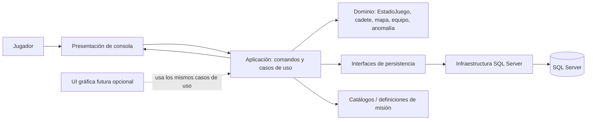

# Arquitectura propuesta

## Objetivo

Evolucionar la aplicación de consola de `feature/mi-codigo-csharp` sin abandonar inicialmente su flujo de juego. Separar dominio, casos de uso, presentación y persistencia. Una interfaz gráfica futura puede invocar los mismos casos de uso, pero no se requiere mantener un proyecto Windows Forms separado en el repositorio.

## Diagrama

## Capas

- **Presentación:** consola ahora; lectura de entrada, formato textual y feedback. Una UI gráfica futura es adaptador opcional. Ninguna interfaz calcula daño, coste ni progreso.
- **Aplicación:** casos de uso: registrar/preparar cadete, iniciar operación, explorar, desplegar dron, activar PEM, responder a anomalía y desconectar.
- **Dominio:** extraer `EstadoJuego` y reglas de `Program .cs` a entidades y servicios puros. Sustituir strings/booleanos/matrices progresivamente por tipos con invariantes.
- **Persistencia:** contratos de repositorio de partida/progreso e implementación SQL Server. La configuración de conexión viene de secretos/entorno, no del código.

## Relación con archivos reales

| Rama de referencia | Cambio propuesto |
|---|---|
| `Nexus_1.slnx` y `Nexus_1/Nexus_1.csproj` | Mantener proyecto consola como ejecutable principal |
| `Nexus_1/Program .cs` | Separar código monolítico por capas; preservar reglas y flujos |
| Clase interna `EstadoJuego` | Extraer a modelo de dominio y validar invariantes |
| `EjecutarMision` y `AbrirSistemasDeAccion` | Casos de uso que devuelven resultados tipados |
| `AnomaliaDetectada` / `DispararAlertaIris` | Evento de dominio/aplicación con suscripción explícita |
| Matrices Génesis/enemigos/zonas | Entidades `Mapa`, `Celda`, `EnemigoInstancia` serializables |

## Flujo de acción

1. Presentación traduce opción a comando tipado.
2. Caso de uso valida saldo, estado y prerequisitos.
3. Dominio aplica la transición y produce resultado/eventos.
4. Repositorio persiste una operación coherente cuando corresponda.
5. Presentación muestra resultado, coste y riesgo actualizado.

Separar primero sin alterar reglas facilita seguir jugando en consola y deja abierta una UI gráfica futura que use la misma lógica.
