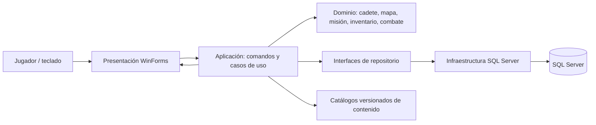

# Arquitectura propuesta

## Objetivo

Conservar Windows Forms para una primera evolución viable, separar presentación, reglas y persistencia, y añadir SQL Server únicamente después de estabilizar las reglas de juego.

## Diagrama

## Responsabilidades

- **Presentación:** formulario/vistas reciben teclado, muestran estado y resultado. Dibujar no cambia vida, recompensas ni estado persistido.
- **Aplicación:** casos de uso como iniciar partida, mover, combatir, usar objeto, reclamar misión, guardar y cargar coordinan dominio y repositorios.
- **Dominio:** entidades y reglas sin referencia a Windows Forms, Graphics o SQL. Validar transiciones, coste, combate e idempotencia de recompensas.
- **Infraestructura:** implementación SQL Server detrás de interfaces; conexión desde configuración local/secretos, nunca hardcodeada. Catálogos pueden iniciar como contenido versionado.

## Relación con lo existente

| Hoy | Evolución |
|---|---|
| `Program.cs` abre Form1 directamente | Configurar servicios y controlador de aplicación |
| `Form1.cs` mezcla Paint, input, mapas, misión, combate | Extraer dominio/casos de uso y luego dividir vistas |
| `Modelos.cs`: Cadete, Enemigo, Mision, Combate | Reutilizar como base de dominio; usar enums/IDs para efectos |
| Mapas y misiones se crean en Form1 | Definiciones `MapaDefinition` y `MisionDefinition` versionadas |
| No hay repositorio de datos | Añadir `ISaveRepository` y repositorio SQL |

## Flujo de un comando

1. UI emite comando sin modificar reglas por su cuenta.
2. Caso de uso valida y ejecuta dominio.
3. Repositorio persiste estado relacionado en transacción.
4. Resultado y modelo de vista vuelven a UI para feedback.

La primera extracción debe preservar movimiento, combate y secuencia de misiones. Persistencia se agrega después para no fijar en tablas reglas todavía inestables.

## Fuera de alcance

No incluye cuentas, nube, multijugador ni telemetría. SQL Server y esta arquitectura son propuestas, no funciones ya presentes.
