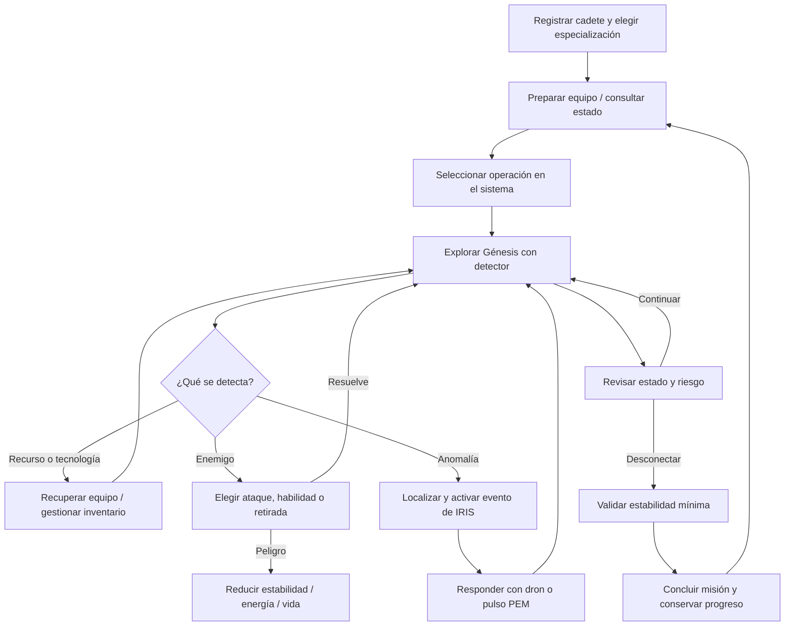

# Diseño del juego NEXUS

## Visión

NEXUS es una experiencia narrativa de ciencia ficción y exploración de supervivencia. El jugador es un cadete que se conecta a la realidad Génesis para localizar anomalías mientras administra recursos y evita que IRIS interfiera con la misión. La fantasía es operar un sistema experimental desde una terminal: preparar equipo, leer señales incompletas, explorar zonas desconocidas y decidir cuándo gastar energía o retirarse.

Motivan a continuar la historia sobre IRIS, ampliar la exploración, recuperar tecnología y descubrir cómo cada especialización cambia el coste de las acciones. Las alertas del sistema y las consecuencias de las decisiones deben hacer visible la tensión.

La interfaz del código de referencia es consola. Los bocetos siguientes describen una experiencia futura deseada; son wireframes conceptuales, no pantallas funcionales ni una indicación de que deba conservarse un prototipo gráfico independiente.

## Ciclo principal



El programa actual presenta un menú de operaciones, movimiento en el territorio, acciones de exploración/equipo y comprobaciones de bloqueo, riesgo y condiciones críticas después de cada acción (el manual informativo no consume turno). La persistencia de progreso es propuesta, no implementada.

## Mecánicas y reglas

### Cadete y clases

El estado `EstadoJuego` incluye nombre, realidad y clases FISICO, ARMAMENTO, MANA y HERRAMIENTAS. El cadete de herramientas reduce costes de dron y PEM. La regla de clase debe explicarse antes de seleccionar y cada coste debe actualizar el HUD.

### Mapa y exploración

Génesis es una matriz de 8×11 con posición del jugador, posición del dron, zonas exploradas y enemigos representados en matrices. Cada casilla equivale a 10 metros. El detector está disponible inicialmente; el dron y el PEM se recuperan durante el flujo. El wireframe de mapa debe priorizar posición, área conocida, señal detectada, peligro, energía y leyenda. En una evolución, mover las matrices a entidades tipadas y guardar la niebla de guerra.

### Energía, estabilidad y poder

El código contiene campos de vida, energía, estabilidad, poder, recursos y estados de capacidad/pulso. La desconexión requiere estabilidad ≥15. Desplegar dron cuesta 5 de energía (3 para HERRAMIENTAS), con mínimo 5; el pulso cuesta 15 (10 para HERRAMIENTAS), con mínimo 15, y bloquea IRIS por tres turnos. Si la capacidad especial está activa, el coste del dron se reduce a la mitad. Poder activa capacidad al umbral 50 durante tres turnos. El panel siempre debe mostrar coste y saldo antes de ejecutar acciones.

### Misiones, anomalías y equipo

La partida actual se conduce mediante operaciones de `EjecutarMision`, sistemas de acción y evento `AnomaliaDetectada` que activa una alerta de IRIS. El estado contempla detector, dron, PEM y recursos recolectados. La documentación no debe afirmar una cadena concreta de misiones/recompensas si no existe como sistema en esta rama. Evolución propuesta: modelar objetivos y resultados de misión con estado tipado y guardado atómico.

El código registra recuperación del dron y módulo PEM, pero no hay una pantalla genérica de inventario. Propuesta: mostrar detector, dron, PEM y recursos recuperados en una lista de equipo, cada uno con estado/coste/acción; evitar inventar objetos consumibles fuera del sistema.

### Riesgo y combate

El jugador puede usar acciones que gastan energía y existen costes de ataques/habilidades por clase. El sistema aplica actualizaciones del bloqueo de IRIS, duración de capacidad y comprobaciones de riesgo/condiciones críticas al avanzar una operación. Una UI futura debe anticipar riesgo, indicar el cambio de valores y mostrar respuesta del sistema. Documentar daño y desenlaces específicos después de contrastar cada rama completa del código.

## Diseño de pantallas y wireframes

Los wireframes son dibujos legibles de una posible interfaz, no interfaz funcional. Deben basarse en la secuencia consola/terminal del programa.

### 1. Menú principal / estado operativo

```text
┌ NEXUS // SISTEMA OPERATIVO ───────────────────┐
│ Cadete: [nombre] · Realidad: GENESIS          │
│ Vida ██████████ Energía ████████ Estabilidad  │
│                                               │
│ [1] Capacidades y equipamiento                │
│ [2] Manual de uso                             │
│ [3] Nexo multiversal                          │
│ [4] Sistemas de acción                        │
│ [0] Desconexión segura                        │
│ Estado de IRIS / alerta reciente              │
└ Seleccione operación · estado y ayuda visibles┘
```

Se corresponde con el menú que actualmente ofrece `EjecutarMision`; el manual es informativo y no consume turno.

### 2. Exploración / mapa

```text
┌ OPERACIÓN: GÉNESIS ───────────────┬ SENSOR ─────┐
│ ? ? ? ? ? ? ? ? ? ? ?             │ Señal: baja │
│ ? · · · ◆ · · · ? ? ?             │ Anomalía    │
│ ? · Cadete · · · ? ? ?             │ Coordenada  │
│ ? · · ⚠ · · · · ? ? ?             │ Dron: listo │
│                                  │ Energía     │
│ WASD / opción: mover             │ Estabilidad │
└ Estado, coste y siguiente acción ┴─────────────┘
```

La lógica real tiene matriz y zonas exploradas; los controles concretos deben respetar el código de la rama al diseñar una interfaz final.

### 3. Misiones / terminal de operación

```text
┌ REGISTRO DE OPERACIÓN ────────────────────────┐
│ Objetivo: investigar señal anómala            │
│ Estado: no localizada / localizada / resuelta  │
│ Pista de NEXUS: [mensaje del sistema]          │
│ Riesgo IRIS: [bajo / alerta / crítico]         │
│                                               │
│ [1] Ver objetivos   [2] Continuar exploración │
│ [3] Volver a base   [0] Desconectar            │
└ Resultado, coste de acción y retroalimentación┘
```

Esta es una propuesta de representación de la operación, no una lista de misiones existente afirmada por el código.

### 4. Cadete / equipo

```text
┌ CADETE ────────────────────┬ EQUIPO ──────────┐
│ Nombre / especialización   │ Detector: activo │
│ Vida                       │ Dron: recuperado │
│ Energía                    │ PEM: disponible  │
│ Estabilidad                │ Recursos: [n]    │
│ Poder / capacidad activa   │ Coste de acción  │
│ [Volver]                   │ [Usar] [Equipar] │
└───────────────────────────┴───────────────────┘
```

La rama actual contempla estos datos de estado; una lista navegable de equipo y sus acciones requiere trabajo de interfaz.

## Experiencia de usuario

- Mantener el lenguaje de sistema/terminal y explicar en palabras comunes cualquier término técnico del juego.
- Jerarquía: acción/objetivo activo, estado de riesgo, recursos y luego detalles narrativos.
- Legibilidad de consola: no depender de ancho fijo excesivo; permitir fallback sin Unicode/color.
- Consistencia entre etiquetas de energía, estabilidad, poder, vida y recursos.
- Mostrar controles y coste junto a cada opción; Escape/volver debe ser predecible.
- Retroalimentar movimiento, detección, recogida, gasto, cambio de riesgo y evento IRIS con texto conciso.
- No depender exclusivamente de color o Beep; ofrecer descripción textual para alertas.
- Requerir confirmación para desconexión si es insegura o una acción irreversible.

## Alcance y restricciones

**Prioridad:** conservar flujo de registro/selección, menú operativo, exploración Génesis, costes de energía/clase, dron/PEM, anomalías y riesgo de IRIS; separar reglas de Console; añadir persistencia SQL Server después de acordar modelo y seguridad; ofrecer UI clara que pueda ser consola primero y gráfica después.

**Opcional:** más realidades, variedad de anomalías/enemigos, progresión por especialidad, presentación audiovisual y accesibilidad extendida.

**Restricciones:** proyecto base es .NET 10 consola; dependencias declaradas deben validarse por uso real. Estado no persistente y contraseña hardcodeada son limitaciones actuales, no diseño final. NEXUS_WF no es requisito para permanecer en el repositorio. SQL Server, guardado/carga y capas separadas son propuestas. No almacenar secretos en Git.
