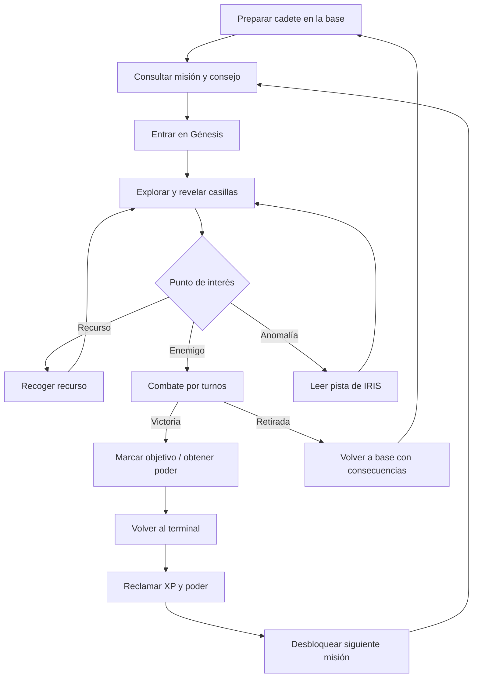

# Diseño del juego NEXUS

## Visión

NEXUS es una aventura de ciencia ficción con exploración táctica y combate por turnos. El jugador encarna a un cadete que se conecta a la realidad simulada Génesis para investigar anomalías y reconstruir qué ocurrió con IRIS. La experiencia combina curiosidad narrativa (archivos incompletos), preparación del personaje y decisiones de riesgo: continuar explorando o regresar a la base.

La motivación para seguir proviene de desbloquear misiones, conocer la verdad sobre IRIS, dominar los efectos de los enemigos y mejorar nivel/poder. Las recompensas deben comunicar qué cambió y abrir el próximo objetivo.

**Estado actual:** el prototipo contiene cuatro clases nominales, dos mapas, tres enemigos y tres misiones. No tiene guardado persistente, SQL Server ni inventario funcional de objetos. Las mejoras se identifican como propuestas.

## Ciclo principal de juego



Actualmente, cada movimiento en Génesis suma cinco metros y reduce turnos de una capacidad activa; el mapa revela casillas cercanas. Se combate al contactar enemigos, y las misiones se reclaman en el terminal de la base.

## Mecánicas y reglas

### Exploradores y clases

En el código el personaje se llama `Cadete`. Se elige FISICO, ARMAMENTO, MANA o HERRAMIENTAS. Hoy son principalmente etiquetas; ARMAMENTO activa el booleano `tieneArma`, sin un sistema general de equipo. La evolución puede otorgar diferencias de habilidad, después de balancearlas. El prototipo es de un único personaje activo.

### Mapas

La base y Génesis son matrices de caracteres definidas en `Form1.cs`. Paredes bloquean movimiento. En Génesis se revelan casillas exploradas; los símbolos representan botiquín, anomalía, elevación, base y enemigos. El HUD muestra posición, distancia, recursos, vida/poder y misión. La evolución debe mover mapas a definiciones validadas y conservar niebla de guerra en el guardado.

### Energía y otros recursos

`Cadete` inicia con Energía, Estabilidad y Vida en 100, Poder en 0. Vida y Poder se usan en el HUD/combate; la desconexión segura requiere estabilidad ≥15. Las capacidades requieren 100 de Poder, consumen el poder y duran tres turnos. Energía existe en el modelo pero casi no participa en el bucle. La propuesta debe darle un propósito claro y mostrar costes antes de confirmar.

### Misiones

Tres misiones lineales tienen como objetivo derrotar enemigos LIQUIDO, FUEGO y VENENO. Solo la misión actual progresa. Al derrotar al objetivo se marca el objetivo cumplido; al regresar al terminal se reclaman 20 de poder y 50 XP y se completa la misión. Los siguientes pasos son extraer misiones como datos y garantizar que la recompensa se reclame una sola vez.

### Inventario

El prototipo solo incrementa `Recursos` al recoger botiquines; no existe pantalla de inventario ni acción para usarlos. La evolución propone una lista pequeña de consumibles y equipo, empezando con botiquín y arma, cantidades visibles y confirmación para objetos escasos.

### Combate

El ataque base inflige 12, el ataque enemigo 10 y huir cuesta 10 de vida. Enemigos tienen 25 de vida. Líquido reduce el daño del jugador a 70%; fuego aumenta el ataque del enemigo 15%; veneno añade 5 de daño por turno tras activarse. Mostrar efecto y resultado con texto además de animación.

## Pantallas, navegación y wireframes

La ventana actual es fija de 960×640 y se dibuja con `Paint`. Los wireframes son esquemáticos; la pantalla de cadete/inventario es propuesta nueva.

### Menú principal

```text
┌ NEXUS // TRAINING SYSTEM ───────────────────┐
│ Cadete: [nombre] Clase: [clase] Nivel: 1    │
│ Vida ██████████  Poder ░░░░░░░░░░           │
│ [1] Capacidades   [2] Manual / archivos      │
│ [3] Nexo multiversal   [0] Desconectar       │
│ Objetivo actual / mensajes del sistema       │
└ ↑↓ navegar · Enter seleccionar ─────────────┘
```

Hoy la selección de clase precede al menú. La evolución añade resumen de misión y “continuar partida”.

### Exploración / mapa

```text
┌ MAPA GÉNESIS ──────────────────┬ INFORMACIÓN ┐
│ ? ? ? ? ? ? ?                  │ Posición    │
│ ? ⌂ · · ◆ · ?                  │ Distancia   │
│ ? · Cadete · ?                 │ Botiquines  │
│ ? · ⚠ · ☠ · ?                 │ Leyenda     │
│ WASD mover · Esc salir         ├ CADETE ─────┤
│                                │ Vida / Poder│
│                                │ Misión      │
└────────────────────────────────┴─────────────┘
```

El prototipo muestra mapa a la izquierda y leyenda/HUD a la derecha; Escape sale al menú. Propuesta: acceso consistente a misión, cadete e inventario y confirmación antes de abandonar una salida.

### Misiones / terminal

```text
┌ NEXUS // TERMINAL DE MISIONES ───────────────┐
│ [1] EL PRIMER OBJETIVO       ACTUAL           │
│     Derrota al enemigo LIQUIDO                │
│ [2] LA PRUEBA DE FUEGO       BLOQUEADA        │
│ [3] EL ÚLTIMO VENENO         BLOQUEADA        │
│ Detalle: consejo, progreso, recompensa         │
│ [S] reclamar al cumplir · [Esc] regresar      │
└───────────────────────────────────────────────┘
```

### Exploradores / inventario (propuesta)

```text
┌ CADETE ────────────────────┬ INVENTARIO ─────┐
│ Nombre y clase             │ Botiquín × 2    │
│ Nivel / experiencia        │ Equipo: arma    │
│ Vida · Energía · Poder     │ Capacidad usada │
│ Estabilidad                │ [Usar] [Equipar]│
│ [Esc] volver               │ descripción     │
└───────────────────────────┴─────────────────┘
```

El actual solo muestra estadísticas; no mantiene lista de objetos ni permite usarlos.

## Experiencia de usuario

- Mantener alto contraste y texto legible; reservar fuente monoespaciada para títulos/datos.
- Poner objetivo y acción principal primero; HUD persistente para recursos esenciales.
- No expresar estados solo mediante color: combinar color con texto/icono.
- Mantener Escape para volver, Enter para confirmar y WASD/flechas para mover.
- Mostrar controles pertinentes en cada pantalla y conservar estado al regresar.
- Confirmar consumo de objetos raros y desconexión; comunicar daño, coste, recompensa y guardado.
- Usar etiquetas junto a iconos y selección/foco evidente.

## Alcance y restricciones

**Prioridad MVP:** conservar el flujo ya existente; extraer reglas de UI; inventario mínimo para inspeccionar/usar botiquines; guardar/cargar progreso local en SQL Server una vez definido el esquema; documentar controles y errores.

**Opcional:** más realidades/mapas, misiones, habilidades balanceadas por clase, equipo, sonido, accesibilidad avanzada, localización, logros y sincronización.

**Restricciones:** Windows Forms y .NET 10 Windows; UI no multiplataforma. No hay hoy SQL, guardado, cuentas ni multijugador. Ventana fija 960×640. No versionar credenciales. Las propuestas no se deben presentar como implementadas.
