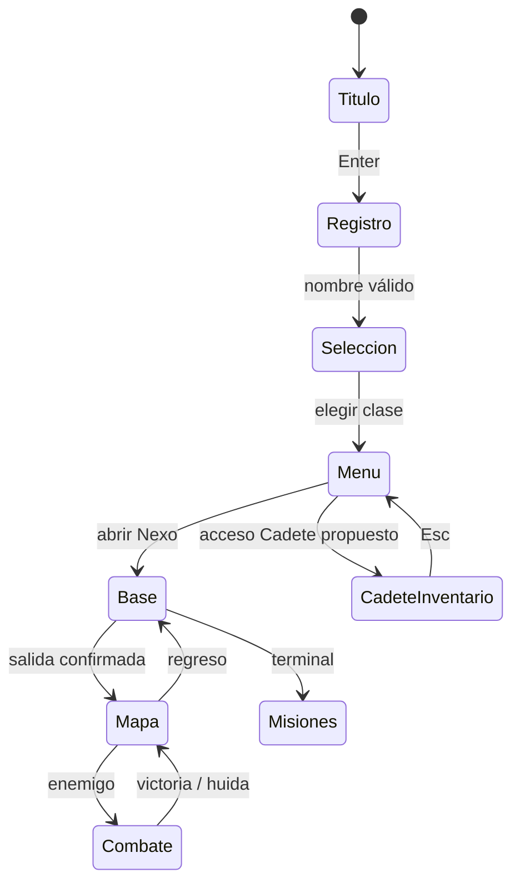

# Evidencias: wireframes y navegación

Bocetos editables de baja fidelidad incluidos en `docs/diseno-del-juego.md`, sección “Pantallas, navegación y wireframes”. Cubren menú principal, exploración/mapa, misiones y cadete/inventario. El último es una propuesta nueva, no una captura funcional.

