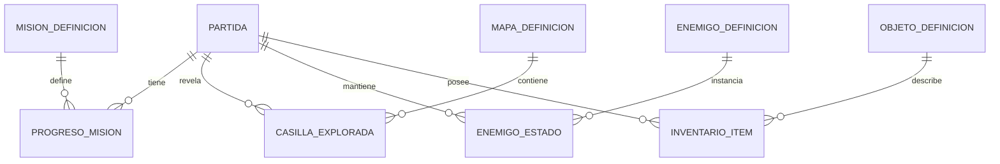

# Modelo de datos propuesto (SQL Server)

## Situación

El prototipo mantiene estado en memoria. Las clases `Cadete`, `Enemigo`, `Mision` y `Combate` existen, pero no hay SQL Server ni guardado. Este esquema propone progreso de un jugador.

## Entidades principales

| Tabla | Datos | Relación |
|---|---|---|
| `Partida` | ID, cadete/nombre/clase, nivel, XP, vida, energía, estabilidad, poder, mapa/posición/distancia, timestamps y versión de esquema | Raíz del estado de una sesión |
| `MisionDefinicion` | ID, orden, descripción, objetivo, consejo, recompensas y prerequisito | Catálogo de misiones |
| `ProgresoMision` | Partida, misión, estado, objetivo cumplido, premio reclamado, fecha | FK a partida y definición; clave compuesta |
| `MapaDefinicion` | ID, nombre, versión, filas/columnas | Catálogo; tiles pueden estar en JSON versionado inicialmente |
| `CasillaExplorada` | Partida, mapa, fila, columna, descubierta | Niebla de guerra por partida |
| `EnemigoDefinicion` | ID, tipo, vida, efecto, daño base | Catálogo de enemigos |
| `EnemigoEstado` | Partida, instancia, mapa, fila/columna, vida, derrotado | Instancias persistentes |
| `ObjetoDefinicion` | ID, tipo, nombre, descripción, efecto, apilable | Catálogo futuro |
| `InventarioItem` | Partida, objeto, cantidad, equipado | FK a partida y objeto |

El inventario sería una evolución: hoy solo existe el contador `Recursos`.

## Relaciones

## Integridad y recuperación

- CHECK vida/energía/estabilidad/poder dentro de 0–100; XP/cantidades no negativos.
- Estado de misión limitado a bloqueada, disponible, objetivo cumplido o completada.
- Clave única por partida/misión; reclamar premio y completar progreso en una transacción para evitar duplicados.
- Validar posición contra mapa al cargar.
- Guardar cambios de acción relacionados juntos; usar `rowversion` para detectar escrituras concurrentes.
- Versionar esquema y contenido. Migrar o avisar ante datos incompatibles, sin reinterpretar posiciones en silencio.

## Estrategia

1. Configurar instancia y credenciales por secretos/entorno, fuera de Git.
2. Inicializar definiciones de misión/mapa/enemigo con seeds idempotentes.
3. Al continuar, cargar partida y estado dependiente.
4. Persistir movimiento relevante, combate, recolección y reclamación en transacciones.
5. Guardar en puntos seguros; evaluar guardado por acción si cierres abruptos son riesgo.
6. Validar dominio e integridad antes de exponer el estado a UI.

EF Core con proveedor SQL Server facilita mapping y migraciones al evolucionar el modelo, con dependencia adicional y necesidad de gestionar migrations. ADO.NET con Microsoft.Data.SqlClient es más explícito y ligero para una vertical slice pequeña. Recomendación: EF Core si el esquema crece, validando proveedor/versión antes de integrar; no está añadido ni probado en el prototipo.
